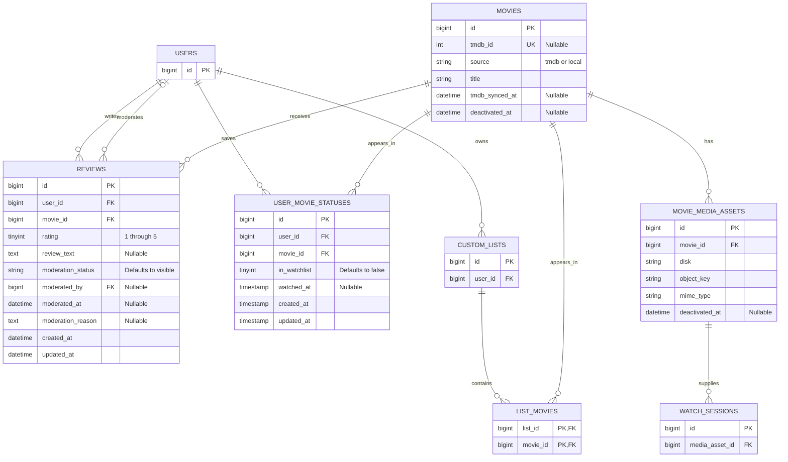

# Movie catalog ERD — AB#69

This diagram describes the target relationships. `users` already exists. Catalog, social, and playback tables are implemented by their respective work items.

`list_movies` uses the `(list_id, movie_id)` pair to prevent duplicate membership. User movie statuses are unique by (user_id, movie_id). Each record independently tracks watchlist membership through in_watchlist and watched status through watched_at. Records with neither status are removed by the Eloquent model's cleanup logic. All `movie_id` columns shown above are required and restrict deletion of the referenced movie. The playback session’s asset reference also restricts deletion. See the [catalog architecture](movie-catalog.md) for the full movie column definitions and lifecycle rules.
Reviews are unique by `(user_id, movie_id)`.