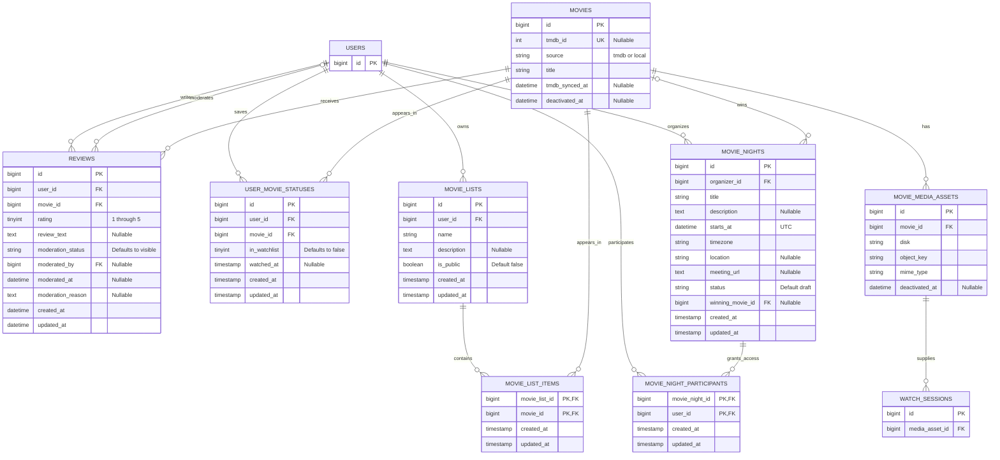

# Movie catalog ERD — AB#69

This diagram combines implemented catalog, review, movie-list, user-status,
and movie-night relationships with planned media/playback relationships.
Movie-night storage is introduced by AB#120. Invitation, voting, and chat
tables belong to their respective work items.

`movie_list_items` uses the `(movie_list_id, movie_id)` pair to prevent duplicate membership.
User movie statuses are unique by `(user_id, movie_id)`. Each record independently tracks watchlist membership through `in_watchlist` and watched status through `watched_at`. Records with neither status are removed by the Eloquent model's cleanup logic.
All `movie_id` columns shown above are required and restrict deletion of the referenced movie. The playback session’s asset reference also restricts deletion. See the [catalog architecture](movie-catalog.md) for the full movie column definitions and lifecycle rules.
Reviews are unique by `(user_id, movie_id)`.
AB#90: deleting an owner cascades to their movie lists and items; deleting a list cascades to its items. Catalog movies are preserved. Logging out does not delete any of these records.

Movie-night organizers and winning movies use restricted deletion.
`winning_movie_id` is nullable and references canonical `movies.id`.

See [movie-night storage and authorization](movie-nights.md) for lifecycle,
time handling, permissions, and the future vote/message write boundary.

AB#121 adds trusted participant membership, unique by
`(movie_night_id, user_id)`. Deleting a night or participant removes its
membership rows. Membership grants read access to non-draft nights; it
does not itself implement invitations, voting, or chat.