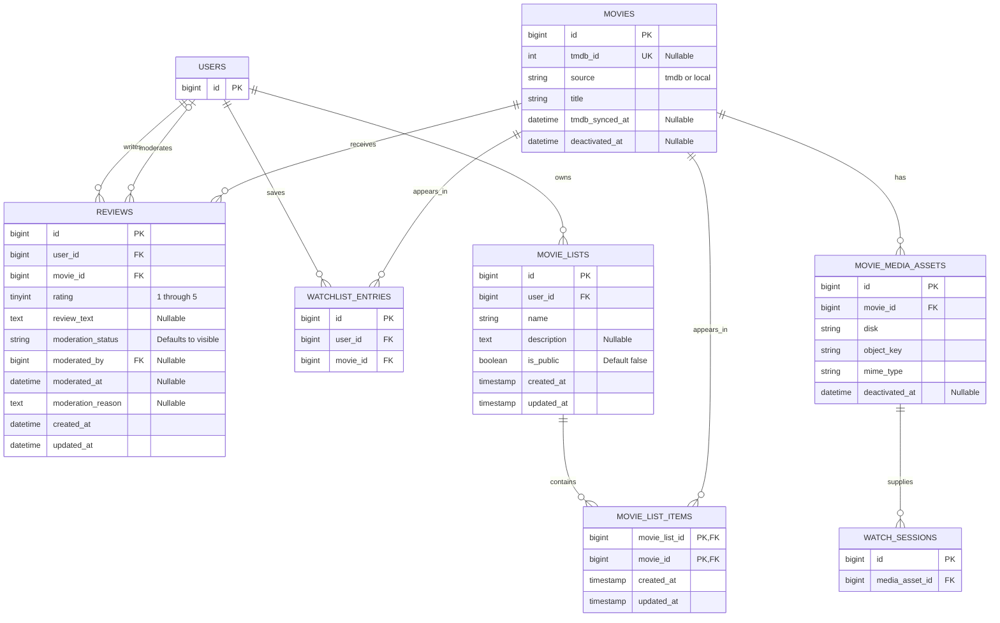

# Movie catalog ERD — AB#69

This diagram describes the target relationships. `users` already exists. Catalog, review, and movie-list tables are implemented. Other social and playback tables belong to their respective work items. Movie-list names follow AB#90.

`movie_list_items` uses the `(movie_list_id, movie_id)` pair to prevent duplicate membership. Watchlist entries are unique by `(user_id, movie_id)`. All `movie_id` columns shown above are required and restrict deletion of the referenced movie. The playback session’s asset reference also restricts deletion. See the [catalog architecture](movie-catalog.md) for the full movie column definitions and lifecycle rules.
Reviews are unique by `(user_id, movie_id)`.
AB#90: deleting an owner cascades to their movie lists and items; deleting a list cascades to its items. Catalog movies are preserved. Logging out does not delete any of these records.
