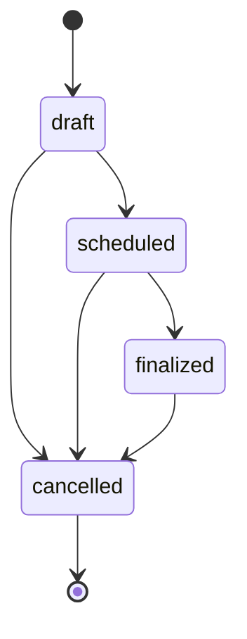

# Movie-night storage and authorization — AB#120

## Scope

This task introduces movie-night storage, relationships, lifecycle rules,
ownership policies, and a transactional write guard.

AB#121 adds the authenticated management API and trusted participant
membership. Invitation delivery, shortlist storage, votes, messages, and
frontend flows remain separate work.

See the [management API contract](../api/movie-nights-contract.md).

## Schema

| Column | Meaning |
| --- | --- |
| id | Generated movie-night identity |
| organizer_id | Required users.id; restricted deletion |
| title | Required plain text, maximum 255 characters |
| description | Nullable plain text, maximum 2000 characters |
| starts_at | Required absolute instant stored as UTC DATETIME |
| timezone | Named timezone for display; default UTC |
| location | Nullable plain text, maximum 255 characters |
| meeting_url | Nullable HTTP/HTTPS URL, maximum 2048 characters |
| status | draft, scheduled, finalized, or cancelled |
| winning_movie_id | Nullable canonical movies.id; restricted deletion |
| created_at / updated_at | Standard timestamps |

The model serializes movie-night, organizer, and winning-movie IDs as strings.

Organizer, status, and winner are not request-mass-assignable fields.

The winner references movies.id, never tmdb_id. Local-only and TMDB-backed
catalog records can both be referenced.

Organizer and winner deletion are restricted while referenced. Account
deletion must explicitly handle organized nights.

A deactivated winning movie remains available through the historical
relationship. Active selection and shortlist-membership validation belong
to the later finalization operation.

## Time handling

The application timezone remains UTC.

Assign starts_at using a DateTimeInterface value or an ISO date-time string
with seconds and an explicit UTC offset.

Example:

- Input instant: 2026-11-28T20:00:00+02:00
- Stored starts_at: 2026-11-28 18:00:00
- Display timezone: Asia/Beirut

The timezone is a named zone validated by Laravel, not a fixed offset string.

Changing timezone alone changes display interpretation without moving the
stored instant.

Future HTTP Form Requests must retain explicit time validation. Browser
datetime-local values must be converted with the chosen timezone before
submission; do not silently interpret them using the server timezone.

Past start instants remain valid for historical records. Time passing does
not automatically change status in V1.

Location and meeting_url are independently optional.

## Lifecycle

The management API defaults to draft and also accepts an explicitly validated
scheduled state on creation. Trusted factories may construct other valid
states directly for fixtures.

- Draft and scheduled nights cannot hold a winning movie.
- Finalized nights require a winning movie.
- The winner is assigned during scheduled-to-finalized transition.
- The winner cannot be replaced after finalization.
- Cancellation preserves a previously chosen winner.
- Cancelled is terminal.
- Organizer reassignment is rejected.

The database enforces references and allowed status values. Cross-field and
transition rules are enforced by the model.

Trusted raw SQL bypasses model lifecycle validation.

## Authorization

| Ability | Organizer permission |
| --- | --- |
| create | Authenticated user; future routes also enforce profile completion |
| view | All statuses |
| update | Draft or scheduled |
| cancel | Draft, scheduled, or finalized |
| vote | Scheduled only |
| sendMessage | Scheduled or finalized |

Guests and unrelated users are denied. Administrators receive no automatic
ownership bypass.

There are no exceptions allowing new votes/messages on cancelled nights.

Reading history is separate from permission to create new activity.

AB#121 permits trusted participants to read scheduled, finalized, and
cancelled nights. Drafts remain organizer-only.

Vote and message permissions remain organizer-only until their respective
features extend participation authorization.

## Application write boundary

MovieNightAccessService exposes:

- update(actor, night, attributes)
- cancel(actor, night)
- forVote(actor, night, writeCallback)
- forMessage(actor, night, writeCallback)

Each method reloads and locks the current movie-night row inside a database
transaction before authorizing the action.

The update method rejects unexpected fields rather than partially accepting
protected assignments.

Future vote/message handlers must perform their database insert inside the
corresponding guard callback.

A policy check against an earlier model instance is insufficient: another
operation may have cancelled or finalized the night since it was loaded.

Cancellation and future finalization must follow the same parent-row locking
discipline as vote/message writes.

Keep database work inside the callback. Dispatch external effects and
broadcasts after commit.

The service does not replace future endpoint authentication, profile
middleware, dedicated Form Requests, or safe API resources.

## Relationships

- MovieNight::organizer() -> User
- MovieNight::winningMovie() -> Movie
- User::organizedMovieNights() -> MovieNight collection
- Movie::winningMovieNights() -> MovieNight collection
- MovieNight::participants() <-> User::participatingMovieNights()

MovieNight::participants() and User::participatingMovieNights() use
movie_night_participants. Invitation, vote, and message relationships remain
unimplemented.

## Verification

Automated:

- MovieNightSchemaTest
- MovieNightAuthorizationTest

Coverage includes schema defaults, UTC normalization, canonical winner
identity, protected fields, status validation, transitions, restricted
deletion, ownership, administrator/guest denial, stale-state guards, and
transaction rollback.

Tests use the existing SQLite-in-memory configuration.

SQLite tests do not establish multi-connection MySQL row-lock contention
results. The development migration check exercises the configured database.

| Check | Result |
| --- | --- |
| Focused schema/lifecycle tests | Pending |
| Focused authorization/service tests | Pending |
| Related catalog/auth regressions | Pending |
| Full backend suite and skip reasons | Pending |
| Development MySQL migration | Pending |
| Manual ownership and stale-state checks | Pending |
| Multi-connection MySQL contention test | Not performed |
| Vote/message HTTP enforcement | Awaiting those feature implementations |

Record actual results and the tested commit before closing the task.